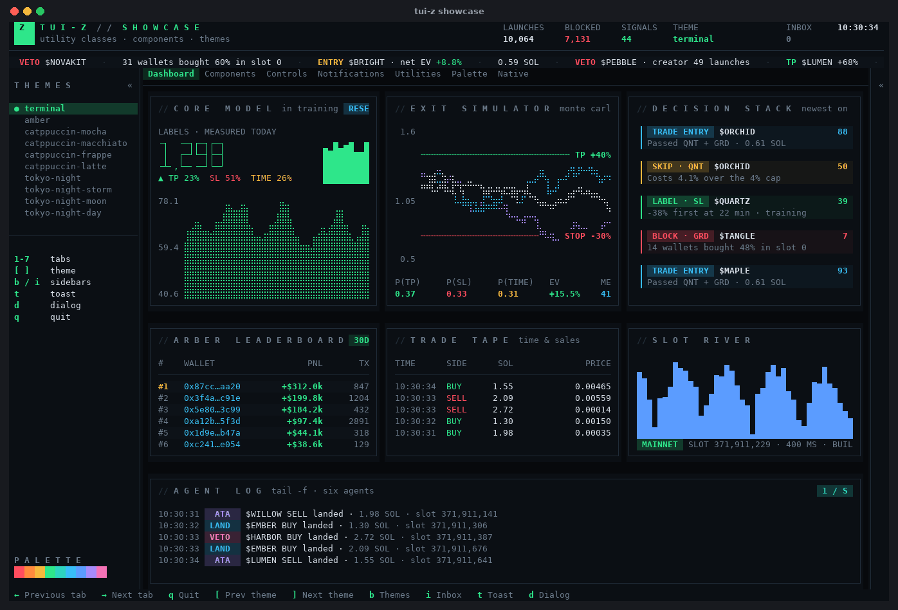

<div align="center">

# tui-z

**Tailwind-style utility classes for Python terminal UIs.**

Build dense, good-looking dashboards and apps with `cls="..."` strings and a set of components, all built on [Textual](https://textual.textualize.io).

[](https://github.com/Zalshy/tui-z/actions/workflows/ci.yml)


[](LICENSE)




<sub>The showcase dashboard, live, cycling through six of the ten built-in themes.</sub>

</div>

```python
from tui_z import TwApp, Panel, Row, Text, Badge, Bar, Button

class Demo(TwApp):
    def compose(self):
        yield Panel(
            Row(Text("Rates cut in Q1?", "bold grow"),
                Text("67¢", "w-6 text-right text-success bold")),
            Bar(0.67, "w-20 text-success"),
            Button("Buy yes", "text-success border-success"),
            title="Live markets",
            badge=Badge("Watching 47"),
            cls="w-60 m-1",
        )

Demo().run()
```

## Why tui-z

Textual is a powerful foundation, but styling a complex screen means writing many stylesheet rules and naming a class for every variation. tui-z brings the Tailwind workflow to the terminal:

- **Style where you build.** `cls="border border-line bg-surface px-1 hover:bg-boost"` sits next to the widget it styles. You don't jump between files or invent class names.
- **Repeatable components.** Components ship their look as `DEFAULT_CLS`, and subclasses extend it. `class Card(Row): DEFAULT_CLS = "border p-1"` gives you a reusable card.
- **Themes for free.** Colors are theme tokens. Ten themes ship built in, Catppuccin and Tokyo Night among them, and switching `app.theme` restyles everything live.
- **Made for live data.** Streaming braille charts, virtualized tables and logs, KPI tiles, tickers. They're built to update many times a second while costing very little.
- **Loud errors.** A typo such as `text-sucess` raises a `TailError`. It isn't silently ignored.

## Install

> tui-z is in **alpha** and isn't on PyPI yet. Install it from GitHub:

```bash
uv add git+https://github.com/Zalshy/tui-z
# or
pip install git+https://github.com/Zalshy/tui-z
```

You need Python 3.12 or newer. The only dependency is Textual.

## Try the showcase

```bash
git clone https://github.com/Zalshy/tui-z && cd tui-z
uv run python demos/showcase.py
```

The showcase has five tabs (Dashboard, Components, Utilities, Palette, Native) and a theme switcher. Use `[` and `]` to cycle themes, `b` to collapse the sidebar, `1`–`5` to switch tabs and `q` to quit. `demos/markets.py` is a smaller, single-screen example.


## A live dashboard in 30 lines

```python
import math
from tui_z import TwApp, Col, Row, Panel, Stat, LineChart, LogView

class Dashboard(TwApp):
    TW_THEME = "tokyo-night"

    def compose(self):
        with Row(cls="h-fr p-1"):
            with Col(cls="w-1/3 md:w-40 mr-1"):      # md: applies at 120+ columns
                yield Panel(
                    Row(Stat("Net PnL", "+$10 554", value_cls="text-success", cls="w-16"),
                        Stat("Win%", "64.4%", value_cls="text-info")),
                    title="Overview",
                )
            with Col(cls="grow"):
                self.chart = LineChart(cls="h-12 text-success", fill=True)
                yield Panel(self.chart, title="PnL curve")
                self.feed = LogView(cls="h-fr")
                yield Panel(self.feed, title="Agent log", cls="h-fr")

    def on_mount(self):
        self.t = 0
        self.set_interval(0.5, self.tick)

    def tick(self):
        self.t += 1
        self.chart.push(math.sin(self.t / 5))      # new data enters on the right
        self.feed.write(f"order {self.t} filled", tag="BUY", tag_cls="bg-success/20 text-success")

Dashboard().run()
```

- Each **unique class string compiles once** to a single generated Textual CSS class, before the widget is first styled.
- For the same property, **the last utility wins**. Your `cls` comes after the component's `DEFAULT_CLS`, so you can override any part of a component.
- Variants stack: `hover:` `focus:` `focus-within:` `disabled:` `first:` `last:` `odd:` `even:` `dark:` `light:` `group-hover:`, plus the breakpoints `sm:` `md:` `lg:` `xl:` (80/120/160/200 columns).
- `tw(widget, "cls")` styles **any** Textual widget: `tw(Input(), "border-none bg-panel")`.

## What's included

| | |
|---|---|
| **Layout** | `Box` `Row` `Col` `Grid` `Scroll` `Spacer` `Divider` `Sidebar` (collapsible) |
| **Content** | `Text` `Label` `Badge` `Stat` `Panel` |
| **Data** | `Table` (virtualized, per-cell styles, zebra/hover rows) · `LogView` (tail log) · `Ticker` (scrolling feed) |
| **Charts** | `Bar` · `Sparkline` · `LineChart` (braille, multi-series, marks, axis, streaming) |
| **Interaction** | `Button` · `ThemeSwitcher` |
| **Themes** | `terminal` `amber` · Catppuccin `mocha` `macchiato` `frappe` `latte` · Tokyo Night `night` `storm` `moon` `day` |

## Documentation

- [Getting started](docs/getting-started.md): your first app, layout and live updates
- [Utility reference](docs/utilities.md): every utility, color and variant
- [Components](docs/components.md): the API of each component
- [Theming](docs/theming.md): built-in themes, switching themes, writing your own
- [Custom components](docs/custom-components.md): reusable building blocks with `DEFAULT_CLS`
- [How it works and performance](docs/internals.md): the compiler, the line API, benchmarks

## Status

tui-z is in **alpha**. The class-string API is the core design and will stay. Component signatures may still change before 1.0. Feedback and issues are welcome.

## Contributing

See [CONTRIBUTING.md](CONTRIBUTING.md). The short version:

```bash
uv sync
uv run pytest
uvx ruff check .
```

## License

[MIT](LICENSE) © Zalshy

Theme palettes come from [Catppuccin](https://github.com/catppuccin/catppuccin) (MIT) and [Tokyo Night](https://github.com/folke/tokyonight.nvim) (Apache-2.0).
